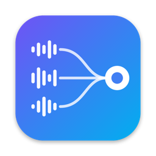

# SoundRouter

A virtual audio router for macOS 14.2+. Create virtual audio devices (up to 64 channels,
44.1–192 kHz), feed each one with a mix of **application audio**, **physical inputs** (USB
interfaces, microphones) and the device's own **pass-thru** output, route channels with per-channel
gains, and monitor the result on real speakers or headphones. Any app (video calls, DAW, screen
recorder, browser) sees the virtual devices as ordinary microphones and outputs.

No audio leaves the Mac, and there is no telemetry.

- [Install](#install)
- [Usage](#usage)
- [Troubleshooting](#troubleshooting)
- [Uninstall](#uninstall)
- [Architecture](#architecture)
- [Development](#development)

## Install

### Requirements

- macOS 14.2 or later (the per-application capture API), Apple silicon or Intel
- Xcode 16 or later, with its command line tools (`xcode-select --install`)
- An administrator account (the audio driver is installed system-wide)

### Build and install from source

```sh
git clone https://github.com/juliens/soundrouter.git
cd soundrouter
make                 # builds build/SoundRouter.app (app + engine + driver)
make install-driver  # installs the audio driver (asks for your password, restarts coreaudiod)
make install         # copies the app to /Applications
```

`make install-driver` restarts `coreaudiod`, so all audio stops for about a second.

Then launch **SoundRouter** from Spotlight, Raycast, Alfred or `/Applications`.

### First launch

1. The setup assistant checks the driver, then enables the **background engine**. macOS may ask
   you to allow a background item: accept (or enable it later in *System Settings › General ›
   Login Items*). The engine keeps your devices working when the app is closed and after a restart.
2. The first time you add an **application** as a source, macOS asks for **audio capture**
   permission: accept.
3. The first time you add a **microphone or audio interface**, macOS asks for **microphone**
   permission: accept.

## Usage

### 1. Create a device

Click **New Device** at the bottom of the sidebar. A new device has 2 channels, a **Pass-Thru**
source and the sample rate of your current output. It immediately appears in
*System Settings › Sound* and in every app's audio menu, under the name you give it.

- **Rename**: click the name in the header (or right-click the device in the sidebar).
- **Sample rate / channels**: header controls (1 to 64 output channels).
- **On/off switch** (sidebar): a device that is off disappears from the system and captures
  nothing. An orange banner reminds you when the selected device is off.
- **Duplicate / Delete**: right-click the device in the sidebar.

### 2. Add sources

Click **+** in the **Sources** column:

| Source | What it captures |
| --- | --- |
| **Running application** | Everything an app plays (captured even before it starts playing). |
| **Installed application…** | Pick an app that isn't running yet; capture starts when it launches. |
| **Input device** | A microphone or audio interface (e.g. a Focusrite Scarlett), or another SoundRouter device. Choose which input channels to use in the source's **Options**. |
| **Pass-Thru** | Whatever apps play *into* this device when they use it as their output. |

Hold **⌥ Option** while opening the menu to also list background processes without a window.

Each source block has:

- an **on/off switch** (the configuration is kept when off),
- a **master volume and mute** for the whole source,
- one row **per channel** (e.g. `In 1`…`In 6` on an audio interface, `L`/`R` for apps) with its own
  mute, volume and level meter,
- **Options**: *Mute application while capturing* (the app is silent on your speakers but still
  captured), or the input channels used for an input device.

A greyed source means its app isn't running or its device is unplugged; it resumes automatically.

### 3. Route channels

The **Outputs** column lists the device's channels — what other apps receive when they use the
device as a microphone.

- **Connect**: drag from a source channel's port (●) to an output port, **or** click a port then
  click the other one.
- **Disconnect**: click a cable to select it, then press **Backspace** or **Delete** (**Esc**
  deselects). You can also right-click a cable › *Delete Cable*.
- **Keyboard / VoiceOver**: right-click any port › *Connect to…* / *Disconnect from…*.

Several sources can feed the same output; they are summed. A new stereo source on a stereo device
is wired 1:1 automatically. Gain, volume and routing changes apply live, without dropouts.

### 4. Use the device in other apps

Select the device as the **microphone / input** in your video call app, DAW, recorder or
browser. If the device has a Pass-Thru source it can also be selected as an **output**: what an
app plays there is mixed back into the device (and into your monitors).

### 5. Listen with monitors

Click **+** in the **Monitors** column and pick your speakers or headphones. Connect output
channels to the monitor's channels (same drag / click / Backspace gestures as above). Each monitor
has its own volume and mute, and a device can have several monitors.

**Latency**: monitoring goes through the computer, so there is a small delay (roughly 20–35 ms
depending on settings). To reduce it, lower the **cycle size** in *Settings › Engine* (128, or 64
if your Mac keeps up without crackles). To hear your own voice with **zero** latency, use your
audio interface's hardware **Direct Monitor** instead.

### Settings

*SoundRouter › Settings…*:

- **General**: open at login, background engine status.
- **Engine**: cycle size (64–1024 frames, smaller = lower latency), log level.
- **Advanced**: export / import the whole configuration as JSON, uninstall.

## Troubleshooting

| Symptom | Fix |
| --- | --- |
| Banner "engine not running" | Click *Retry*, or check *System Settings › General › Login Items* (SoundRouter must be allowed). Restart the engine with `launchctl kickstart -k gui/$(id -u)/io.soundrouter.engine`. |
| An app source stays silent, no permission prompt | Reset the permission, relaunch SoundRouter and accept the prompt: `tccutil reset AudioCapture io.soundrouter.app`. |
| Microphone / interface silent, no prompt | `tccutil reset Microphone io.soundrouter.app`, relaunch, accept. |
| Permissions lost after rebuilding | Expected with locally (ad-hoc) signed builds: run `tccutil reset All io.soundrouter.app` after each `make install`, or sign with a stable identity (see [Signing](#signing-and-distribution)). |
| Nothing is captured or mixed at all | Check the device's on/off switch in the sidebar. |
| An audio interface doesn't appear | It must first appear in *System Settings › Sound › Input* (check cable, use a port directly on the Mac rather than a hub). SoundRouter picks it up automatically once macOS sees it. |
| The device doesn't appear in other apps | Check the driver is installed: `ls /Library/Audio/Plug-Ins/HAL/SoundRouter.driver`, otherwise `make install-driver`. |

Logs: `log stream --info --predicate 'subsystem == "io.soundrouter.engine"'` (engine) and
`subsystem == "io.soundrouter.driver"` (driver).

## Uninstall

From *Settings › Advanced › Uninstall* in the app, or from a checkout:

```sh
make uninstall               # KEEP_CONFIG=1 keeps ~/Library/Application Support/SoundRouter
rm -rf /Applications/SoundRouter.app
```

This stops the engine, removes the driver and the configuration, and restarts `coreaudiod`.

## Architecture

Three components (details and contracts in [docs/ARCHITECTURE.md](docs/ARCHITECTURE.md)):

| Component | What | Where |
| --- | --- | --- |
| HAL driver (`SoundRouter.driver`) | AudioServerPlugIn loaded by `coreaudiod`; publishes the devices listed in `/Library/Application Support/SoundRouter/devices.json`; exchanges audio with the engine through shared memory | `Driver/` (C) |
| Engine (`SoundRouterEngine.app`) | LaunchAgent (`io.soundrouter.engine`): process taps, input capture, drift-compensated real-time mix, monitors, XPC service `io.soundrouter.engine.xpc` | `Sources/SoundRouterEngine`, `Sources/SRCore` (C real-time core) |
| Control app (`SoundRouter.app`) | SwiftUI editor: devices, sources, routing, monitors, meters, setup assistant. Never touches audio. | `Sources/SoundRouter` |

Shared model and XPC contract: `Sources/SoundRouterKit`. The configuration lives in
`~/Library/Application Support/SoundRouter/config.json`, owned by the engine.

## Development

```sh
make test          # unit tests: mix core, resampler, ring buffers, config logic, driver
make run-offline   # the app with a fake in-process engine (no driver/engine needed)
make install       # rebuild and reinstall the app in /Applications
make srctl         # build/srctl, a command-line client of the engine (integration tests)
make lint          # bash -n on scripts, plutil -lint on plists
```

- Integration tests for a real Mac with SoundRouter installed: see
  [IntegrationTests/README.md](IntegrationTests/README.md) (device visibility, bit-exact pass-thru,
  application capture, endurance).
- In sandboxed shells where SwiftPM cannot write its caches: `source Scripts/env.sh`, then
  `srbuild <name>` / `srtest <name>`, or `SR_SANDBOXED=1 Scripts/build.sh`.
- `Scripts/make-icon.swift` regenerates the app icon.

Repository layout:

```
Driver/            HAL plug-in (C), its Makefile and tests
Sources/           SRCore (C real-time core), SoundRouterKit, SoundRouterEngine, SoundRouter
Tests/             unit tests
Resources/         Info.plist templates, LaunchAgent plist, entitlements, icon, pkg scripts
Scripts/           build, install-driver, uninstall, make-pkg, make-dmg, notarize, make-icon
IntegrationTests/  real-hardware tests and checklists
docs/              architecture and contracts
```

### Signing and distribution

Without `SIGN_IDENTITY`, everything is ad-hoc signed: fine for local use, but macOS forgets the
audio permissions on every rebuild. With a certificate:

```sh
export SIGN_IDENTITY="Developer ID Application: Name (TEAMID)"
export INSTALLER_IDENTITY="Developer ID Installer: Name (TEAMID)"
make && make pkg && NOTARY_PROFILE=<notarytool-profile> make notarize
```

`make pkg` builds an installer that puts the app in `/Applications` and installs the driver;
`make dmg` builds a disk image. Sparkle auto-updates are not integrated yet (see
`Resources/appcast.xml` for the template).

### Known limitations

- Installing or updating the driver restarts `coreaudiod`, briefly interrupting all audio.
- Rebuilding the app invalidates its background-item registration; the app re-registers the
  engine automatically on its next launch (allow a few seconds).
- With ad-hoc signing the engine's XPC service accepts only the app (`io.soundrouter.app`);
  `srctl` needs the same signing identity as the engine.

## License

MIT — see [LICENSE](LICENSE).
